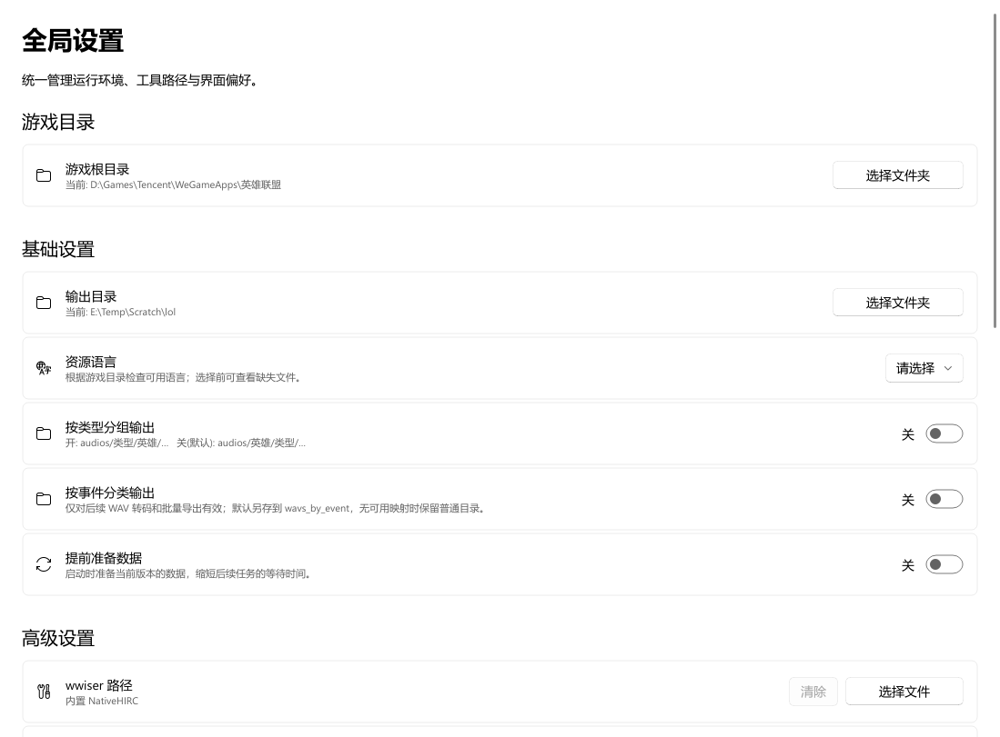
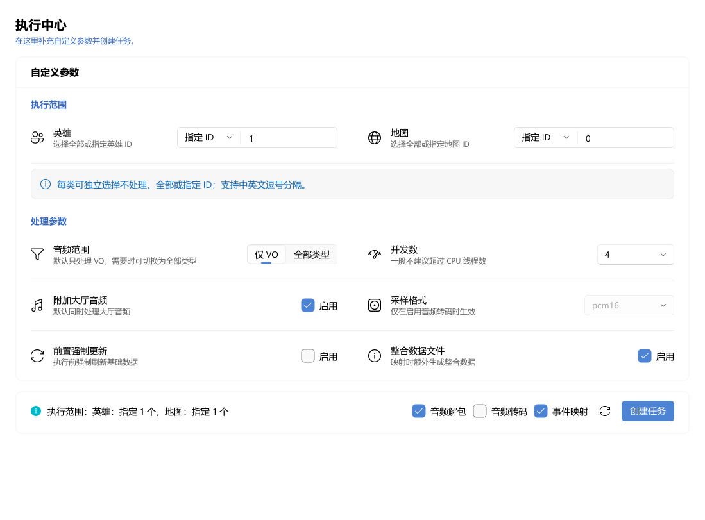
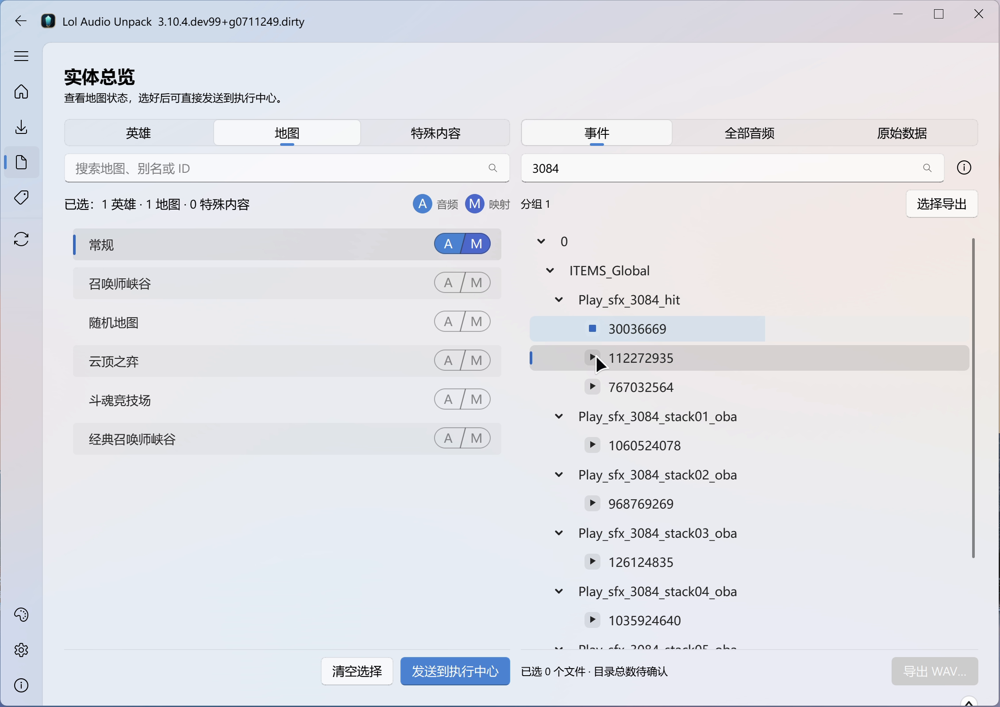
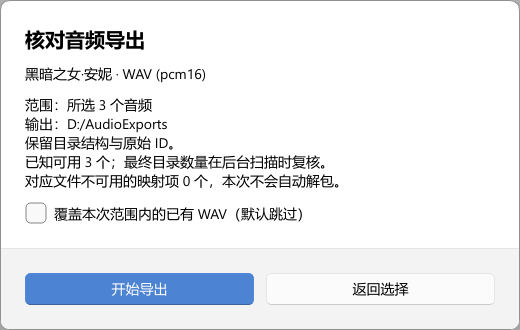

# 界面使用说明

从 [GitHub Releases](https://github.com/Virace/lol_extract_voice/releases/latest) 下载 Windows x64 界面版，直接打开。
从源码启动的方法见 [README](../../README.md#从仓库运行)。
Linux、macOS 等系统使用源码入口，平台说明见 [常见问题](../faq.md#platforms)。
可以使用已安装客户端，也可以使用外部准备的 [本地游戏目录](../api/prepared_source.md)。

## 准备目录

第一次启动时跟随引导，设置游戏目录和输出目录。也可以进入“全局设置”修改。
等待英雄、地图列表准备完成后，再选择处理对象。

游戏目录应指向包含 `Game/` 的客户端根目录；输出目录用来保存数据、原始音频、WAV 和报告。
需要切换语言时，选择本地客户端已有的资源语言。
想减少任务开始时的等待，可在“基础设置”开启“提前准备数据”，默认关闭。

## 创建任务

1. 打开“执行中心”，为英雄或地图选择“指定 ID”，填入需要的 ID，例如安妮 `1`、常规地图 `0`。
2. 勾选音频解包；需要按事件查找时，再勾选事件映射。需要整批 WAV 时勾选音频转码。
3. 点击“创建任务”，核对对象、动作与参数；确认后开始执行。

### 音频类型

界面只提供 **“仅 VO”和“全部类型”** 两个简化选项，没有逐项细分音效和音乐。
“仅 VO”用于语音；需要特殊音效、背景音乐或不确定类型的音频时选择“全部类型”。
具体分组见 [音频类型](../audio-and-output.md#audio-types)。

任务范围与参数

#### 选择对象

英雄和地图分别设置，可以只处理其中一类。初次打开时均为“不处理”。

| 范围 | 如何使用 |
| --- | --- |
| 不处理 | 跳过这一类对象 |
| 全部 | 处理该类普通对象；特殊内容需单独选择 |
| 指定 ID | 输入所需 ID，如 `1，103,555`，支持中英文逗号；留空不会变成“全部” |

> **先核对 ID。** 确认窗口会列出未找到的 ID；只有部分有效时只处理有效对象，全部无效时不能执行。

#### 动作与采样格式

| 需要的结果 | 勾选动作 |
| --- | --- |
| 原始 WEM 音频 | 音频解包 |
| 按事件查找音频 | 事件映射 |
| 整批 WAV 文件 | 音频转码 |

转码默认输出 **16 位 PCM WAV**，需要其他采样格式时在“采样格式”中选择。

“发送到执行中心”只同步选择并跳转，不会执行或打开确认窗口。
点击“创建任务”后核对名字、ID 和参数；“确认”开始执行，“返回修改”保留表单。

## 查找与试听

处理完成后进入“实体总览”，选中英雄或地图。按事件名筛选，展开事件，点击音频旁的播放按钮试听。
搜索的是事件名和资源标识，可以先用片段筛选，再逐条试听确认。

实体总览按“英雄 / 地图 / 特殊内容”分类，`A` 表示已有音频，`M` 表示已有事件映射。
有映射时可以按事件查找；没有映射时，仍可在“全部音频”里试听、导出和打开文件位置。
大型地图首次打开“全部音频”可能需要等待，可查看列表上方的加载进度。

## 选择并导出 WAV

点击“选择导出”，可以按目录、事件节点或单条音频选择已有 WEM，再批量导出 WAV。
支持全选、排除、清空、撤销和仅看已选；确认时请核对范围和覆盖选项。
选择只针对当前实体，不会跨实体累积，也不会自动解包缺失文件。

选择需要的音频后指定目标目录，在核对窗口确认导出数量、采样格式和覆盖选项，再开始导出。

> **需要编辑音频时，先导出 WAV 或复制到输出目录之外。** 不要直接修改库内原始音频。

导出目录

#### 文件位置

界面、控制台与源码运行的目录规则相同，见 [统一输出目录](../audio-and-output.md#output-folders)。
手动导出时，**所选目录就是导出根目录**，不会额外增加一层 `wavs/`。
单条“另存为”使用指定的文件位置。

## 特殊内容与本地资源包

“经典召唤师峡谷”等结构化特殊内容直接来自当前客户端，选中后可发送到执行中心处理。
它们不会在普通英雄列表中重复出现。

要查找额外资源包，在实体总览搜索栏旁的更多菜单中选择“扫描本地 WAD…”，
选取当前游戏 `Game/DATA/FINAL` 下需要的 `.wad.client`。程序只扫描所选文件，
扫描后仍需创建解包任务。

扫描后可在资源包列表查看发现状态和处理结果。
资源包暂不支持执行中心的整包 WAV 转码；已有 WEM 可以在总览中试听和选择导出。

## 查看结果与处理失败

任务完成后，可以从通知打开结果详情；关闭通知后，仍能在执行中心点“查看本次结果”。
失败时先看原因，修正后重试；重试前请核对处理范围。仍然失败时保留日志，便于排查。

目前一次执行一个任务，没有多任务队列和暂停续跑功能。

## 设置保存与旧数据

界面自动保存设置：打包程序使用 EXE 同目录的 `lol-audio-unpack.ini`，
从仓库运行时使用当前目录的同名文件。修改设置请使用“全局设置”。

旧版输出在启动时自动迁移，无需重新解包；遇到迁移错误时，请按提示处理后重启。
其他问题见 [常见问题](../faq.md)。
